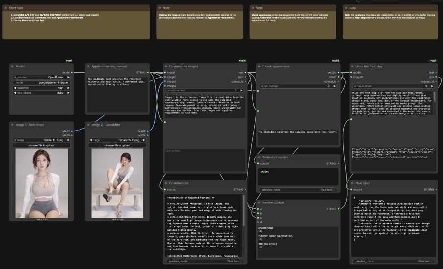
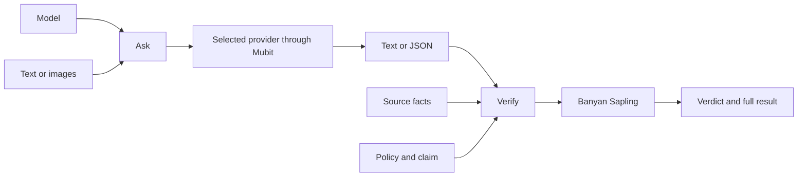

# 

[](#requirements)
[](#requirements)
[](LICENSE.md)

Use connected models through Mubit to write text, inspect images, and return structured answers.
Check claims against evidence with Banyan Sapling.

## Contents

- [Requirements](#requirements)
- [Install](#install)
- [First run](#first-run)
- [Example workflows](#example-workflows)
- [Nodes](#nodes)
- [How a run works](#how-a-run-works)
- [Learning from calls](#learning-from-calls)
- [Development](#development)
- [Common problems](#common-problems)
- [License](#license)

## Requirements

- Python 3.12 or later and ComfyUI 0.37.2 or later.
- A Mubit key and a connected provider with access to your chosen model.
- A deployed Banyan Sapling endpoint for Verify.

Choose a chat model. Image inputs, structured output, and reasoning require support from the selected model.

## Install

From your ComfyUI folder, using its Python environment:

```sh title="From the ComfyUI folder"
git clone https://github.com/stefanionescu/comfyui-mubit.git custom_nodes/mubit
python -m pip install -r custom_nodes/mubit/requirements.txt
```

## First run

Connect your provider in the [Mubit console](https://app.mubit.ai/console/).
Set the server environment before starting ComfyUI:

```sh
export MUBIT_API_KEY='<your-mubit-key>'
export SAPLING_ENDPOINT='https://<your-deployment>.endpoints.huggingface.cloud'
python main.py
```

If your Sapling deployment requires a token, set `SAPLING_API_KEY` too.
Restart ComfyUI after changing its environment. Provider keys stay in Mubit.

Find **Model**, **Ask**, and **Verify** under **mubit** in the node menu.
Choose the provider and its model ID in **Model**, then connect it to **Ask**.

## Example workflows

Open **Templates**, then **Extensions**, then **mubit**, or drag a JSON from `example_workflows` onto the canvas.
Both templates use mubit and stock ComfyUI nodes. Compare starts on OpenRouter; choose your provider in Model.

| Workflow                                           | What it does                                                                                        |
| -------------------------------------------------- | --------------------------------------------------------------------------------------------------- |
| [Draft](example_workflows/mubit-01-draft.json)     | Check a supplied draft and corrected draft against the same product facts.                          |
| [Compare](example_workflows/mubit-02-compare.json) | Inspect two images, verify an appearance requirement, and propose an edit or request more evidence. |

In Draft, edit **Product facts** and the claim in each Verify node.
The original adds waterproof and battery claims absent from the facts. The supplied correction uses only those facts.
Run to compare both calibrated verdicts and full results.

For Compare, upload [female-15-1.png](example_workflows/assets/hosts/female-15-1.png) as **Reference** and
[female-15-2.png](example_workflows/assets/hosts/female-15-2.png) as **Candidate**.
Edit **Appearance requirement** to define what the candidate must preserve.
Ask reads both images in socket order. Verify checks the current observation against that requirement.
The final Ask uses the full result to return `action`, `prompt`, and `reason`:

- `keep`: Sapling supports the requirement; return an empty prompt.
- `edit`: a violation and observed mismatch justify a focused editing prompt.
- `review`: uncertain or conflicting evidence requires a closer view or more information.

The editing prompt proposes a next step for your image generator. Compare returns text and JSON.
Replace either image or the requirement to check another case.



## Nodes

| Node                              | Purpose                                                                        | Outputs                              |
| --------------------------------- | ------------------------------------------------------------------------------ | ------------------------------------ |
| [Model](web/docs/MubitModel.md)   | Choose the provider, model ID, reasoning, and output limit.                    | Model settings                       |
| [Ask](web/docs/MubitAsk.md)       | Submit instructions, a prompt, optional images, and an optional answer schema. | Text, parsed JSON, request ID        |
| [Verify](web/docs/MubitVerify.md) | Check a claim against a policy and text evidence.                              | Verdict, complete result, request ID |

Model supports OpenRouter, OpenAI, Anthropic, Gemini, Groq, Together, and Mistral through Mubit.
Enter any chat model ID your selected provider serves. Use **default** reasoning to keep the model's own setting.
Connect the same Model output to several Ask nodes to share settings.

Leave **json_schema** empty for text. Supply a JSON Schema object for a structured answer.
Connect outputs to stock **Preview as Text** nodes or the next workflow stage.

## How a run works



Ask requests appear in Mubit Requests. Verify calls the configured Sapling endpoint with text evidence.
For media checks, Ask supplies observations of the connected images.

Verify preserves `supported`, `violation`, `insufficient_information`, `inconsistent_context`, or `unsure`.
Interpret the verdict with the claim: support for a defect claim means the defect needs attention.
Keep unresolved results unresolved. The full result includes probabilities and calibration details;
its raw label does not replace the calibrated verdict.

Ask and Verify each submit one request with a 300-second deadline. Identical inputs use ComfyUI's cache;
change **run_number** for a fresh request. **Stop** cancels the local request.
The provider may continue work already submitted. Errors stop execution without automatic retries.

## Learning from calls

Keep a recurring task's instructions, model, and answer schema stable. Put changing facts and observations in **prompt**.
Mubit groups these calls and manages eligible adapter training. Follow your task and any trained versions in its console.
See [Mubit's training guide](https://docs.mubit.ai/guides/first-adapter) for workspace access and example requirements.

Review replies with the **Good** and **Bad** ratings in [Requests](https://docs.mubit.ai/guides/requests).
Rate the model's answer to its task:
an inspector that correctly identifies a bad image has performed its task correctly.

Compare an available passing adapter with its provider model in **Try models**.
Adapter names do not identify provider models. See [Mubit's model ID guide](https://docs.mubit.ai/guides/model-ids).

## Development

Install [Bun](https://bun.sh/) and [uv](https://docs.astral.sh/uv/), then run from this repository:

```sh
bun install --frozen-lockfile
uv venv --python 3.12
uv pip install --python .venv/bin/python -r requirements.txt
bun run --no-install gspot install
bun run --no-install gspot check
```

Add the ComfyUI root and its environment's `site-packages` directory to `comfyui.pth` in the development
Python environment's `site-packages`. The checks then read the installed host interfaces.
Git hooks run gspot. Check staged changes with `bun run --no-install gspot check --staged`.

## Common problems

| Symptom                    | Check                                                                                    |
| -------------------------- | ---------------------------------------------------------------------------------------- |
| Missing key or endpoint    | Set the server environment and restart ComfyUI.                                          |
| Provider rejects a request | Check the provider connection, model ID, supported inputs, and request details in Mubit. |
| Missing example images     | Upload the included files through Reference and Candidate.                               |
| Verdict stays `unsure`     | Read the evidence and prediction set in the full result.                                 |

Failed Ask calls include the Mubit request ID when supplied.

## License

[MIT](LICENSE.md).
