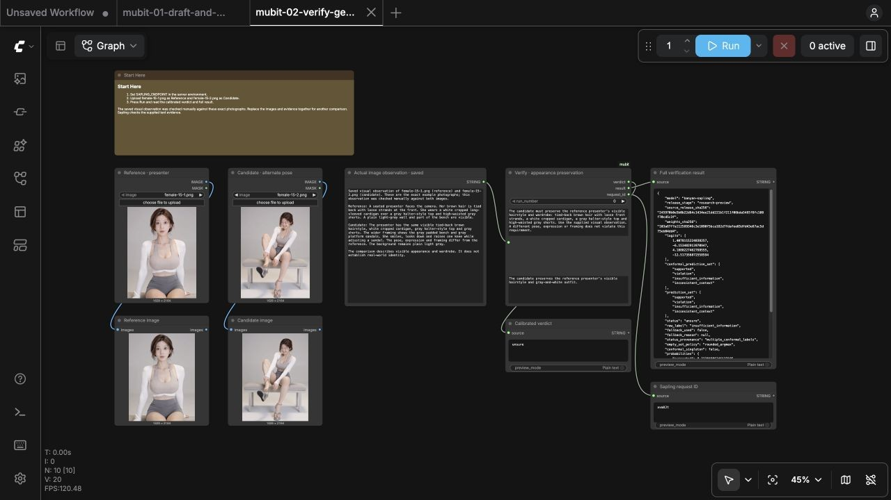
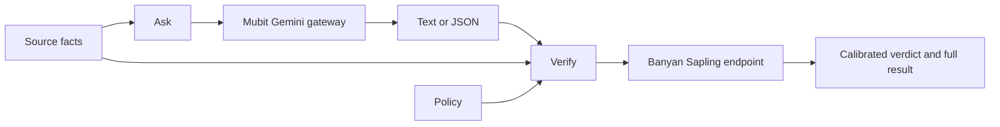

# 

[](#requirements)
[](#requirements)
[](LICENSE.md)

Ask Gemini through Mubit. Check a claim against evidence with Banyan Sapling.
Connect the returned text, JSON, verdict and request IDs to your ComfyUI workflow.

## Contents

- [Requirements](#requirements)
- [Install](#install)
- [First run](#first-run)
- [Example workflows](#example-workflows)
- [Nodes](#nodes)
- [How a run works](#how-a-run-works)
- [Development](#development)
- [Common problems](#common-problems)
- [License](#license)

## Requirements

- Python 3.12 or later.
- ComfyUI 0.37.2 or later.
- A Mubit account with a connected Gemini provider and access to the selected model.
- A deployed Banyan Sapling endpoint.

Both nodes take text inputs. For images or video, an inspection model must first describe the actual media.

## Install

From your ComfyUI folder, using its Python environment:

```sh title="From the ComfyUI folder"
git clone https://github.com/stefanionescu/comfyui-mubit.git custom_nodes/mubit
python -m pip install -r custom_nodes/mubit/requirements.txt
```

## First run

Set these environment variables before starting the ComfyUI server:

```sh
export MUBIT_API_KEY='<your-mubit-key>'
export SAPLING_ENDPOINT='https://<your-deployment>.endpoints.huggingface.cloud'
python main.py
```

Connect your Gemini provider in the [Mubit console](https://app.mubit.ai/console/).
Ask uses the Mubit key; your Google key stays in your Mubit provider configuration.
If your Sapling deployment requires authentication, also set `SAPLING_API_KEY` to its dedicated service token.
Restart ComfyUI after changing the server environment.

Find **Ask** and **Verify** under **mubit** in the node menu.

## Example workflows

Open **Templates**, then **Extensions**, then **mubit**, or drag a workflow JSON from `example_workflows` onto the canvas.
Both examples use mubit and stock ComfyUI nodes. Start with the **Start Here** note.

| Workflow                                                                                 | What you see                                                                                                                 |
| ---------------------------------------------------------------------------------------- | ---------------------------------------------------------------------------------------------------------------------------- |
| [Draft and verify](example_workflows/mubit-01-draft-and-verify.json)                     | Product facts feed Ask and Verify. Inspect the structured script, calibrated verdict, complete result, and both request IDs. |
| [Verify generation evidence](example_workflows/mubit-02-verify-generation-evidence.json) | Two photographs of the selected presenter and a saved visual observation demonstrate an appearance-preservation check.       |

For the second example, upload [female-15-1.png](example_workflows/assets/hosts/female-15-1.png) and
[female-15-2.png](example_workflows/assets/hosts/female-15-2.png) through the corresponding **Load Image** nodes.
The first photo provides the reference appearance; the second shows the same presenter in another pose.
The saved visual observation describes that exact pair. Queue the graph to verify the claim against that observation.
Replace the images and evidence together when checking another pair.



The images demonstrate the evidence path. The workflow uses saved observations; queueing it runs verification.
In a generation controller, inspect each new image or clip first, pass those current observations to Verify,
then use the result to choose the next generation action.

## Nodes

| Node                              | Inputs                                                                   | Outputs                                                 |
| --------------------------------- | ------------------------------------------------------------------------ | ------------------------------------------------------- |
| [Ask](web/docs/MubitAsk.md)       | Run number, reasoning, model, instructions, prompt, optional JSON Schema | Text, parsed JSON, Mubit request ID                     |
| [Verify](web/docs/MubitVerify.md) | Run number, policy, evidence, claim                                      | Calibrated verdict, complete result, Sapling request ID |

Ask defaults to `gemini-4-argon` with high reasoning. Your account must have access to the selected model.
Leave JSON Schema empty for text. Supply a JSON Schema object to request structured output.

Verify returns the service's calibrated status:

| Verdict                    | Meaning                                                    |
| -------------------------- | ---------------------------------------------------------- |
| `supported`                | The supplied evidence supports the claim under the policy. |
| `violation`                | The claim violates the policy.                             |
| `insufficient_information` | The evidence lacks information needed to judge the claim.  |
| `inconsistent_context`     | Conflicting context prevents a consistent judgment.        |
| `unsure`                   | Calibration does not select one definite label.            |

Interpret the verdict together with the claim. Support for a defect claim means the defect needs attention.
Incomplete, conflicting, or uncertain evidence stays unresolved. The complete result preserves prediction sets,
probabilities, the raw label, and calibration provenance. A raw label does not replace the calibrated verdict.

## How a run works

Each execution sends one request, with a 300-second deadline. Press **Stop** to cancel the local request.
The provider may continue processing a request already submitted. Errors stop the node without automatic retries.
Identical inputs use ComfyUI's normal cache. Change **run_number** to send a fresh request.



Ask requests appear in Mubit Requests. Verify calls your Sapling endpoint directly; its request ID comes from that service.

## Development

Install [Bun](https://bun.sh/) and [uv](https://docs.astral.sh/uv/), then run these commands from this repository:

```sh
bun install --frozen-lockfile
uv venv --python 3.12
uv pip install --python .venv/bin/python 'aiohttp>=3.12,<4'
bun run --no-install gspot install
bun run --no-install gspot check
```

Add the ComfyUI root and its environment's `site-packages` directory to a `comfyui.pth` file in the development
environment's `site-packages` directory. The Python checks then read the actual host interfaces.
gspot also runs through the local Git hooks. Check staged changes with `bun run --no-install gspot check --staged`.

## Common problems

| Symptom                     | Check                                                                                                        |
| --------------------------- | ------------------------------------------------------------------------------------------------------------ |
| Missing API key or endpoint | Set the server environment variables, then restart ComfyUI.                                                  |
| HTTP 401 or 403             | Check the key for that service and the deployment's access settings.                                         |
| HTTP 429                    | Check the provider's request details, quota, and billing. Decide whether to retry after resolving the error. |
| Missing example photos      | Upload the included photos through the two Load Image nodes.                                                 |
| Verdict stays `unsure`      | Read the prediction set and evidence. Preserve the calibrated status.                                        |

Failed Ask calls include the Mubit request ID when supplied. Use that ID to investigate the call with Mubit.

## License

Code uses the [MIT license](LICENSE.md).
